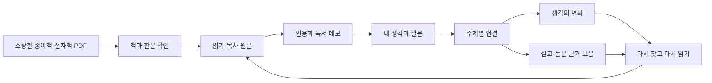

# 평생 읽고 다시 생각하는 지식서재

연구 검토 및 적용 기준 · 2026-10-14

## 1. 지식서재의 목적

이 서재의 성공은 저장한 책의 수보다, **필요한 자료를 다시 찾고, 그때 내 생각을 이해하고, 지금의 판단에 활용할 수 있는가**로 평가한다. 종이책·전자책·PDF를 모두 포함하되 독서와 사유에 집중한다. 일정 관리나 잡다한 프로젝트 관리는 넣지 않는다.

개인정보관리 연구는 정보를 보관하는 활동과 필요할 때 다시 찾는 활동을 연결해서 본다. 따라서 저장 화면만 잘 만드는 것으로 충분하지 않다. ‘왜 남겼는가’, ‘어떤 상황에서 다시 볼 것인가’, ‘어디에서 읽었는가’를 복원할 수 있어야 한다. 이 방향은 Jones 등의 개인 정보 관리 연구에서 가져왔고, 독서 중심으로 좁힌 것은 이 앱의 설계 판단이다. [Jones 외, Personal Information Management](https://arxiv.org/abs/2107.03291), [Jones, Keeping Found Things Found, 공개 1장](https://booksite.elsevier.com/samplechapters/9780123708663/Sample_Chapters/02~Chapter_1.pdf)

일상 흐름은 **읽기 → 밑줄과 메모 → 내 말로 정리 → 주제에 연결 → 필요할 때 다시 찾기 → 생각 수정**이다. AI가 이 흐름을 대신 수행하거나 저장할 때마다 판단하지 않는다. 초기 정비와 사용자가 요청한 제한된 비교에만 보조적으로 사용한다.

## 2. 검토한 주요 자료

아래 표는 확인한 자료와 앱에 적용할 판단을 구분한다. 논문·표준·실무서는 근거의 종류가 다르며, 특정 기록법이 모든 독자에게 효과적이라는 실험 결과로 확대 해석하지 않는다. 출판사의 책소개와 목차만 확인한 자료는 전문을 읽었다고 간주하지 않았다.

| 자료 | 확인한 범위와 핵심 | 이 서재에 적용할 내용 |
|---|---|---|
| William Jones 외, *Personal Information Management* (백과사전 장 2017, 공개본 2021) | 공개 논문. 보관·조직·유지·재발견을 개인의 필요와 연결 | 날짜·책·읽은 상황·내 표현 등 여러 단서로 다시 찾기 |
| William Jones, *Keeping Found Things Found* (Morgan Kaufmann, 2008) | 출판사 소개·목차 및 공개 1장 | 정보 수집뿐 아니라 유지 비용과 재사용 성공을 평가 |
| Marti A. Hearst, *Search User Interfaces* (Cambridge, 2009) | 저자 공개본의 구성·설계 원칙 및 출판사 정보 | 검색어 입력, 결과 이해, 조건 조절, 검색 과정의 맥락 유지 |
| Hearst, “UIs for Faceted Navigation: Recent Advances and Remaining Open Problems” (2008) | 저자 소속 대학 공개 논문 | 분야·형태·책장·날짜·기록 종류를 독립된 조건으로 조합 |
| IFLA, *Library Reference Model* (2017 기본 모델) | 공식 공개 표준의 이용자 과업과 주요 개체 | 작품·번역/개정 내용·판본·내 소장본을 구분하고 찾기·식별·선택·접근·탐색 지원 |
| W3C, *SKOS Primer* (2009) | 공식 문서의 대표어·별칭·상하위·관련 관계 | 공식 분류와 개인 주제를 구분하고 주제의 별칭을 검색에 활용 |
| W3C, *Web Annotation Data Model* (2017) | 공식 권고의 본문·대상·문장/위치 선택자·상태 | 내 메모와 인용 대상을 분리하고 문장·쪽수·파일 버전을 함께 보존 |
| International ISBN Agency, ISBN assignment | 공식 안내의 권차·판형·번역·개정판 규칙 | 같은 제목도 다른 판본일 수 있음. 제목 검색 결과를 ISBN 확정으로 취급하지 않음 |

직접 출처:

- [Personal Information Management 공개본](https://arxiv.org/abs/2107.03291)
- [Keeping Found Things Found 출판사 정보·목차](https://www.sciencedirect.com/book/9780123708663/keeping-found-things-found)
- [Search User Interfaces 저자 공개본](https://searchuserinterfaces.com/book/), [Cambridge 출판사 정보](https://www.cambridge.org/core/books/search-user-interfaces/D8AF2DFEF2BF553463025F243D0BFA52)
- [Hearst의 다면 탐색 논문](https://people.ischool.berkeley.edu/~hearst/papers/hcir08.pdf)
- [IFLA LRM 2017 공식 본문](https://www.ifla.org/wp-content/uploads/2019/05/assets/cataloguing/frbr-lrm/ifla-lrm-august-2017.pdf), [개정본이 포함된 공식 저장소](https://repository.ifla.org/handle/123456789/40). 세부 표준 구현 전에는 개정본과 대조하며 이 문서는 전체 표준 준수를 주장하지 않는다.
- [SKOS Primer](https://www.w3.org/TR/skos-primer/)
- [Web Annotation Data Model](https://www.w3.org/TR/annotation-model/)
- [ISBN 배정 규칙](https://www.isbn-international.org/node/88)

## 3. 사용자에게 보이는 전체 구조

홈에서는 지금 읽는 책, 최근 기록, 다시 보고 싶은 기록을 보여 준다. 책 상세에서는 소개·목차·내 기록을 먼저 보여 주고, 출처·판본 일치 근거·수정 이력은 펼쳐 볼 때 보여 준다. 검토가 필요한 항목도 모든 화면에 경고처럼 늘어놓지 않고 한곳에서 정리한다.

이 문서의 핵심 구조는 설계 방향이다. 아래 구현 현황 표에 표시하지 않은 화면과 동작까지 이미 구현됐다는 뜻은 아니다.

## 4. 데이터를 구성하는 기준

### 책, 판본, 내 소장본

‘넥서스’라는 작품, 특정 한국어 번역, 특정 출판사·발행판, 내가 가진 종이책과 PDF 파일은 구분한다. 같은 책으로 연결하더라도 페이지·ISBN·보관 위치·독서 이력을 합쳐서 잃지 않는다. 스캔 PDF는 원래 종이책의 ISBN을 증거로 사용할 수 있지만, 그 번호를 별도로 발행된 전자책 ISBN이라고 표시하지 않는다.

IFLA 모델의 구분을 앱에 맞게 단순화하되, 당장 모든 자료를 새로운 네 개 테이블로 옮기지 않는다. 현재 도서·PDF 식별자를 보존하면서 판본 관계와 소장본 관계를 점진적으로 추가한다. [IFLA LRM](https://www.ifla.org/wp-content/uploads/2019/05/assets/cataloguing/frbr-lrm/ifla-lrm-august-2017.pdf), [ISBN 규칙](https://www.isbn-international.org/node/88)

### 원문, 정리 자료, 내 생각

| 층 | 예시 | 변경 원칙 |
|---|---|---|
| 원자료 | PDF, iReadItNow 원본 기록, 도서관 응답 | 원본과 확인 시점을 보존 |
| 근거 | PDF의 특정 문장·페이지, 판권면 ISBN | 파일·쪽수·추출 방식·버전 연결 |
| 보조 정리 | 서지 보완, 소개, 목차, 검색 태그 | 제공자/규칙/AI를 구분, 숨김·수정 가능 |
| 내 기록 | 내 말로 쓴 메모·질문·비판·생각 | 자동 덮어쓰기 금지, 수정 이력 보존 |
| 관계 | 근거, 반론, 확장, 변화, 동일 판본 후보 | 누가 어떤 이유로 연결했는지 보존 |

이 구분은 기존 데이터베이스를 유지하면서 사용할 책임 경계다. 보조 정리가 많아져도 내 문장과 섞이지 않는다.

### 분류와 태그

- **도서관 분류:** 책이 속하는 공식 분야. 실제 조회한 KDC와 제목·폴더로 추정한 분야를 구분한다.
- **개인 주제:** 고통, 인간 본성, 정서 조절, 신앙과 과학처럼 여러 분야를 가로지르는 관심.
- **태그:** 다시 찾기 위한 가벼운 표식. 예: 다시 읽기, 강의에 활용, 질문 남음.
- **책장:** 사용자가 의도적으로 만든 모음. 분야·주제를 대신하지 않는다.

개인 주제는 고유 ID, 대표 이름, 다른 표현, 정의, 상위·하위·관련 주제를 가진다. 예를 들어 ‘감정’과 ‘정서’를 자동으로 완전히 같은 개념으로 합치지 않는다. 분야별 의미 차이를 설명하고 별칭이나 관련 주제로 연결한다. 이는 SKOS의 구분을 참고한 적용안이며 RDF 서버나 그래프 전용 DB를 당장 도입할 필요는 없다. [W3C SKOS](https://www.w3.org/TR/skos-primer/)

## 5. PDF 식별과 정보 수집

1. **원본 확인:** 일반 도서 범위인지, 파일이 바뀌지 않았는지 확인한다. 논문·간행물은 기본정보만 유지한다.
2. **가벼운 조사:** 이미 생성한 색인에서 앞 12쪽·뒤 8쪽을 읽는다. 긴 책 전체를 다시 OCR하지 않는다. 아직 OCR되지 않은 쪽은 대기로 남긴다.
3. **ISBN 후보:** ISBN-10/13 검산, 발견 쪽수, 원문/OCR 구분, 문장 근거와 페이지 해시를 기록한다. OCR 오독을 숫자로 추측해 고치지 않는다.
4. **제공자 조회:** 같은 ISBN을 우선 조회하고, ISBN이 없거나 일치하지 않으면 제목으로 판본 후보를 찾는다.
5. **판본 판정:** 광고·참고문헌 번호, 세트·개별 권차, 양장·문고 번호가 섞이면 검토 대상으로 남긴다. 제목 일치만으로 확정하지 않는다.
6. **고신뢰 보완:** 선택한 앞뒤 페이지의 추출·OCR이 완료되고, 원문 ISBN·권차/판 표시를 유지한 정확한 제목·단일 판본과 파일/책 버전 확인이 모두 충족될 때만 빈 서지 필드를 채운다. 사람이 수정한 책과 기존 값은 보존한다. 전후 이력과 제공자 자료를 한 번에 저장하며, 중단 시 일부만 반영되지 않게 한다.
7. **추가 자료:** 확인된 판본의 서지·분류·표지 주소·소개를 연결한다. 목차와 리뷰 참고 소개는 별도 수집·검수 단계다.

‘ISBN 검산 성공’은 번호 형식의 정확성일 뿐 그 책의 번호라는 보장이 아니다. ‘같은 제목 검색됨’은 다른 번역·개정판을 배제하지 못한다. 이 두 단계를 섞지 않는 것이 잘못된 표지와 인용을 줄이는 핵심이다. [ISBN 공식 안내](https://www.isbn-international.org/node/88)

도서관 정보나루 설명서 v20260620의 51쪽은 표지 URL 이미지를 비영리 화면 표시에 한정하며 복사·저장·재배포 및 AI 입력·학습 등의 활용을 금지한다고 안내한다. 따라서 이 경로의 표지는 **외부 주소로 표시**하고 오프라인 이미지 수집 대상으로 두지 않는다. PDF 첫 페이지 미리보기와 사용자가 가진 표지는 별개다. 목차·소개·리뷰도 제공처별 허용 범위와 판본 일치 여부를 확인한다.

## 6. 검색과 연결

검색의 기본 단위는 책 전체만이 아니라 책, 목차 항목, 원문 문장, 내 메모, 주제다. 검색 결과에는 어떤 종류의 결과인지와 일치한 문맥을 보여 준다. 찾은 문장에서는 한 번의 동작으로 원문 쪽으로 돌아가도록 한다.

제목을 잊었어도 ‘작년에 읽음 + 상담 + 내가 남긴 메모’로 좁힐 수 있게 한다. 분야·형태·날짜·책장·기록 종류를 독립적으로 조합하고 선택한 조건은 쉽게 해제한다. 첫 화면에 모든 분류를 펼치지 않는다. [Hearst, 다면 탐색](https://people.ischool.berkeley.edu/~hearst/papers/hcir08.pdf), [Search User Interfaces](https://searchuserinterfaces.com/book/)

범주 안에서만 검색하면 신학과 상담처럼 중요한 교차 연결을 놓칠 수 있다. 따라서 ‘같은 주제의 자료’를 우선 보여 주고 ‘관련 주제에서 찾기’를 별도로 제공한다. 단어가 같다는 이유만으로 주장이나 생각이 같다고 판정하지 않는다. 전문 임베딩이나 벡터 DB 도입 전에 별칭·필터·원문 검색이 실제 질문을 얼마나 해결하는지 평가한다.

## 7. 사유의 지도

기본 화면은 거대한 점·선 그래프보다 **한 주제의 시간순 기록**이다. 각 기록에는 내 생각인지 책의 주장인지, 당시 날짜가 확실한지, 어떤 원문을 근거로 했는지가 붙는다.

변화 관계는 유지·확장·수정·입장 전환으로 표현하되 연결 이유를 사람의 문장으로 남긴다. 기록을 고쳤다는 사실과 실제 입장이 바뀌었다는 판단은 구별한다. 인용이 많은 책을 내 입장으로 추정하지 않는다. 사용자가 확인한 관계를 중심으로 그래프를 보조 표시한다.

예: ‘고통은 해결해야 한다’라는 과거 기록과 ‘고통을 함께 견디는 관계도 중요하다’라는 최근 기록을 같은 주제에 놓는다. 두 문장이 모순인지 확장인지 자동 확정하지 않고, 사용자가 이유와 영향을 준 책을 연결한다. 날짜를 모르면 불명으로 둔다.

AI는 사용자가 고른 두 기록의 차이와 근거 후보를 제시하는 선택 기능이다. 전체 책을 매번 전송하거나 사용자의 입장을 생성하지 않는다. 모델 성능보다 발화 주체·날짜·인용 대상·판본 정보가 먼저 정확해야 한다.

## 8. 설교·논문에 활용

자료 모음은 원문 인용, 내 해석, 주장, 근거, 반론을 질문별로 배열하는 공간으로 확장한다. 현재 자료 모음 기능을 바탕으로 ‘이 주장을 무엇이 뒷받침하는가’, ‘반대 근거는 무엇인가’를 볼 수 있게 한다. 작성 당시의 서지와 인용을 보존한다.

Zotero는 검증된 서지·인용 형식·연구 자료 관리의 연결 지점으로 사용한다. 이 앱의 독서 이력·개인적인 생각 변화까지 Zotero 항목으로 억지로 바꾸지 않는다. CSL JSON/RIS 서지 내보내기와 Zotero 항목 주소의 식별자 연결을 구현했다. 실제 사용자 서재와의 자동 양방향 동기화는 별도 권한과 충돌 규칙을 정한 뒤 다룬다.

## 9. 정확성과 장기 보존

인용은 문장, 앞뒤 문맥, PDF 페이지, 인쇄 쪽수, 파일 식별자, 확인 시점을 함께 갖는다. OCR 문장은 확인 전 표시를 유지한다. W3C 주석 모델은 메모와 대상, 문장 선택자 및 대상 상태를 분리하므로 이러한 보존 구조의 참고가 된다. 여기서 파일 해시를 더하는 것은 이 앱의 구현 선택이다. [W3C Web Annotation](https://www.w3.org/TR/annotation-model/)

원본·온라인 기록·색인·캐시는 복구 가치가 다르다. 원본과 내 기록을 우선 별도 매체에 백업하고, 재생성 가능한 색인은 그다음이다. 내보내기 파일이 생성된 사실보다 빈 환경에 실제 복원되는지를 검수한다. 색인과 캐시는 외장하드를 사용한다.

## 10. 구현 상태와 적용 순서

| 단계 | 현재 상태 | 다음 완료 기준 |
|---|---|---|
| 목록·독서·기록 | 도서 수정, 책장, 분야, 달력·통계, 메모·태그·검색 구현 | 실제 독서 흐름에서 혼동되는 입력과 표시 점검 |
| 판본 식별 | 두 차례 전체 조사 완료, 이 구현 단계의 검증된 PDF 44개 안전 반영. 혼합 표본과 추가 검수에서 서로 다른 ISBN 30개 확인 | OCR 정상 종료 후 앞뒤 쪽 재조사, 모호한 판본의 사용자 검토 |
| 원문·인용 | 페이지 색인·뷰어·인용 구현, OCR 진행 | 오류·빈 결과 구분, 인용 표본 검수 |
| 목차·소개 | 일반 PDF 4,064개 조사, 품질 검수한 내장 목차 1,069개·인쇄 목차 후보 766개 저장, 현재 제공자 소개 1,565개 | OCR 이후 후보 재조사, 미발견 자료 보완과 원문 검토. 외부 리뷰 전문의 일괄 재배포는 완료 범위가 아님 |
| 주제·검색 | 확인한 주제의 별칭·하위·관련 주제 검색과 일치 이유 구현 | 사용자의 실제 질문·정답 자료로 유용성 평가 |
| 사유의 지도 | 날짜·발화 주체·근거를 구별한 수동 비교와 판단 수정 이력 구현 | 실제 생각 변화는 사용자가 확인; AI 비교는 별도 실자료 평가 |
| 자료 모음 | 질문·주장·근거·반론 배치, 서지 교환과 Zotero 식별자 연결 구현 | 실제 Zotero 서재에서 교환 확인; 자동 동기화 별도 |
| 외부 사용 | 본인 인증·PWA 정적 화면·기기 초안·충돌 처리·비공개 PC 링크·읽기 전용 MCP 구현 | 실제 배포 승인, 휴대폰 검수, PC 네트워크와 클라이언트 연결 |

먼저 판본 식별을 완료하고, 목차·소개, 자료 검수, 사유의 지도 실사용 개선, 외부 접근·Zotero 순서로 진행한다. 모든 단계를 한 번에 새 구조로 교체하지 않는다.

## 11. 평가 기준

아래 수치는 연구가 보장한 성능이 아니라 이 앱의 제안된 검수 목표다.

- **다시 찾기:** 실제 질문 20개와 정답 자료를 사용자가 정한다. 상위 5개 내 발견율, 원문 도달 시간, 놓친 이유를 기록한다. 목표는 80% 이상이며 미달 원인을 먼저 개선한다.
- **판본:** 서로 다른 권차·번역·판형·OCR 오독을 포함한 고신뢰 후보 표본 30건에서 잘못된 자동 확정 0건을 요구한다. 표본 통과가 전체 무오류를 보장하지는 않는다.
- **인용:** native/OCR을 나눈 표본에서 문장·쪽수·판본을 확인한다. OCR 검토 전을 정확한 인용으로 표시하지 않는다.
- **생각 변화:** 실제 기록 쌍 30개에서 날짜·발화 주체·근거가 정확한지 확인한다. 사용자가 유용하다고 확인한 연결만 확정한다.
- **보존:** 재실행해도 중복 반영하지 않고, 수동 수정·다른 사용자의 자료·논문/간행물 상세 내용은 변경하지 않는다. 복원 후 내 기록과 이력이 같아야 한다.
- **편리함:** 기록 저장 시 필수 분류를 최소화한다. 검색과 상세 화면의 반응 시간, 불필요한 클릭 수를 실제 PC와 휴대폰에서 측정한다.

## 12. 이번 단계에서 하지 않는 것

로컬 생성형 AI 재설치, 전체 자료의 자동 요약, 사용자 생각의 자동 판정, 제목만으로 판본 병합, 정보나루 표지의 일괄 이미지 저장, 그래프 DB 전면 교체는 하지 않는다. 필요가 확인되면 별도 근거와 검수 기준을 갖춘 뒤 추가한다.
